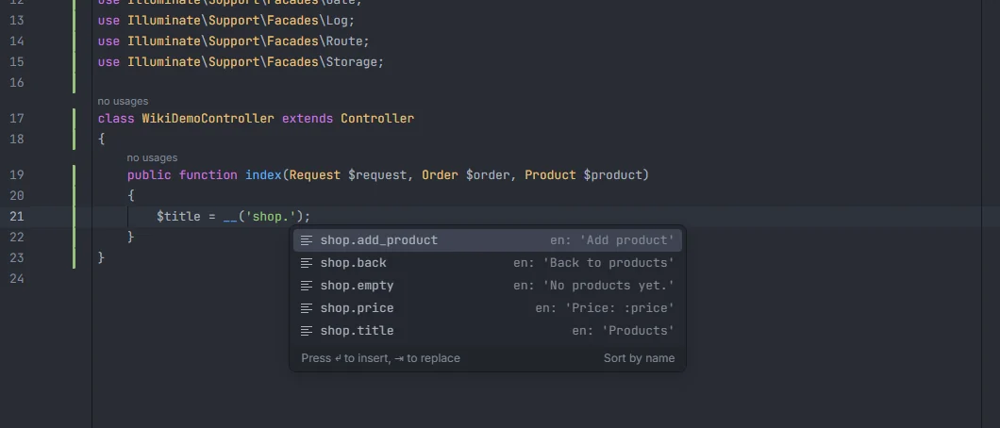
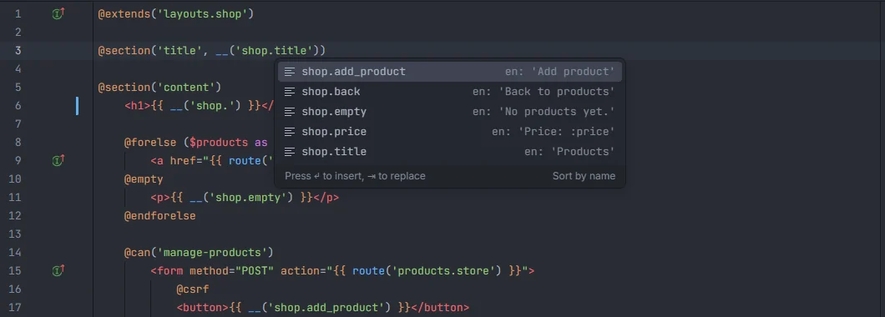

# Translations

Translation keys complete in `__()`, `trans()`, `trans_choice()`, the `Lang` facade and Blade's `@lang` and `@choice`, from your PHP and JSON language files, with the text in your preferred locale next to each key. Ctrl+click opens the key in every locale, and a missing key can be added to the language file with one quick fix.

<p align="center"></p>
<p align="center"><sub>Keys of <code>lang/en/shop.php</code>, each with its text in the preferred locale</sub></p>

## How to use it

Type inside the quotes of the first argument:

| Call or directive | Where |
| --- | --- |
| `__('…')` | PHP, Blade |
| `trans('…')` | PHP, Blade |
| `trans_choice('…', $count)` | PHP, Blade |
| `Lang::get('…')`, `Lang::has('…')`, `Lang::choice('…', $count)` | PHP, Blade |
| `@lang('…')` | Blade |
| `@choice('…', $count)` | Blade |

```php
$title = __('shop.title');
$label = trans_choice('shop.items', $count);
if (Lang::has('auth.failed')) { /* … */ }
```

```blade
<h1>{{ __('shop.title') }}</h1>
<p>@lang('shop.empty')</p>
```

<p align="center"></p>
<p align="center"><sub>The same keys inside <code>{{ __('shop.') }}</code> in Blade</sub></p>

In Blade, PHP calls work inside `{{ }}`, `{!! !!}`, `@php … @endphp` and on directive lines, not in plain HTML text or component attributes.

The translation helpers of JavaScript, TypeScript, Vue and Svelte files (`__`, `trans`, `trans_choice`, `$t`, `t`, `$tc`, `wTrans`, `transChoice`) are covered on [Front-end files](Frontend-Files.md).

## What you see

| Key | Detail |
| --- | --- |
| `shop.title` from `lang/en/shop.php` | `en: 'Products'` |
| `Welcome` from `lang/pt_BR.json` | `pt_BR: 'Bem-vindo'` |
| `auth.providers` (an array or other non-text value) | `en` |

Each key is listed once. When a key exists in several locales, the suggestion uses the preferred locale's entry (the `locale` setting, `en` by default); when the preferred locale doesn't have the key, the first other locale found is shown.

Suggestions whose key starts with what you typed come first, then the ones that only contain it, each group in alphabetical order. Typing filters by substring, ignoring case, so `__('empty')` finds `shop.empty`. At most 500 suggestions are listed. Picking one replaces the whole string.

## Where the keys come from

| Files | Keys |
| --- | --- |
| `lang/{locale}/**/*.php` and `resources/lang/{locale}/**/*.php` (up to 5000 each) | The file path below the locale folder, with `/` as `.`, then every nested array key: `lang/en/shop.php` → `shop.title`; `lang/en/admin/users.php` → `admin.users.title` |
| `lang/{locale}.json` and `resources/lang/{locale}.json` | Every top-level key, as is: `"Welcome back"` |

- `lang/vendor/` (published package translations) is skipped.
- Both `lang/` (Laravel 9 and newer) and `resources/lang/` (older versions) are read, so either layout works.
- PHP files are read as text, not run. Values are shown when they are a string, number, bare word or `env()` call.

## Ctrl+click

Ctrl+click on a key lists the key in every locale that has it (`lang/en/shop.php`, `lang/pt_BR/shop.php`…), at the key's string, so you can jump to the translation you want to edit.

## Add a missing key

When the key under the cursor exists in no locale, Alt+Enter offers to add it to the preferred locale:

| Quick fix | When | What it writes |
| --- | --- | --- |
| *Add 'shop.subtitle' to lang/en/shop.php* | The key has a dot, no spaces, and `lang/{locale}/{file}.php` (or `resources/lang/…`) exists | `'subtitle' => 'subtitle',` before the file's last `]`, with a comma added after the previous entry when needed |
| *Add 'Welcome back' to lang/en.json* | `lang/{locale}.json` (or `resources/lang/{locale}.json`) exists | `"Welcome back": "Welcome back"` before the last `}` |

When both fixes are possible, the PHP file is the preferred one. The text written is the key itself; replace it with the real translation.

## Details

- The preferred locale is read when the plugin starts. After changing the `locale` setting, reload the window or restart the plugin for completion and the quick fix to follow it.
- The index is rebuilt after a file under `lang/` or `resources/lang/` changes, in the editor or on disk.
- Keys built at runtime (`__("shop.{$name}")`) can't be completed past the static part.
- The plugin doesn't report unknown translation keys as warnings; it only offers the quick fix.
- Nothing here runs PHP.

## Settings and permissions

| Setting | Default | Effect |
| --- | --- | --- |
| `locale` (*Preferred translation locale*) | `en` | Which locale's text appears in suggestions and where the *Add* quick fix writes |

Only `project.read` is needed to complete and navigate. The quick fix edits the language file in the editor. See [Settings](Settings.md) and [Permissions](Permissions.md).

## Related

- [Rename translation](Rename-Translation.md): change a key and update every usage and the other locales
- [Front-end files](Frontend-Files.md): translation keys in JavaScript, Vue and Svelte
- [Blade](Blade.md)
- [Translations in the hub](Hub-Translations.md)

---
[← Wiki home](Home.md)
