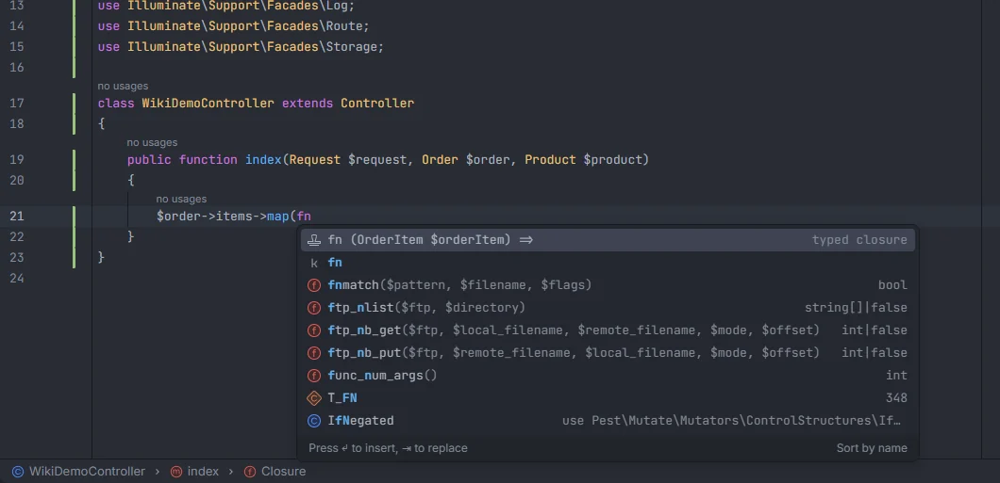

# Typed closures

When a call takes a callback, typing `fn` or `function` as its argument offers the whole closure with its parameter already typed for that call: `fn (OrderItem $orderItem) =>` in `$order->items->map(`, `fn (Builder $query) =>` in `where(`, `fn (Blueprint $table) =>` in `Schema::create(`. The class is imported for you, so the language server and the plugin both know what the parameter is.

<p align="center">items->map(fn offering fn (OrderItem $orderItem) => as a typed closure" width="760"></p>
<p align="center"><sub><code>$order->items->map(fn</code> offers <code>fn (OrderItem $orderItem) =></code></sub></p>

## How to use it

Right after `(` or `,` of a call, type `fn` or `function` (or any start of them, such as `f`) and pick one of the two items:

```php
$users->map(fn                      // fn (User $user) => …
User::where(fn                      // fn (Builder $query) => …
User::query()->chunk(100, fn        // fn (Collection $users) => …
Schema::create('posts', fn          // fn (Blueprint $table) => …
DB::transaction(function            // function () { … }
```

- `fn (…) =>` inserts the arrow function and leaves the cursor after `=>`.
- `function (…)` inserts a closure with a body and leaves the cursor inside it.
- When a parameter's class lives in another namespace and isn't imported yet, a `use` statement is added under the existing ones (or under `namespace`).

## What you see

Two items, both with the snippet icon and the detail `typed closure`, sorted before everything else: `fn (User $user) =>` and `function (User $user)`. The parameter is named after its class with a lowercase first letter (`OrderItem` → `$orderItem`), and a collection of models is named in the plural (`Collection $users`).

## Details

### Calls on models, queries and collections

The receiver of the call is worked out the same way as for [Eloquent chains](Eloquent-Chains.md). Then:

| Receiver | Call and argument | Closure parameters |
| --- | --- | --- |
| Collection of `User` | `map`, `each`, `filter`, `reject`, `first`, `last`, `sortBy`, `sortByDesc`, `groupBy`, `keyBy`, `mapWithKeys`, `flatMap`, `sum`, `avg`, `max`, `min`, `contains`, `every`, `partition`, `unique`, `transform`, `search`, `skipUntil`, `skipWhile`, `takeUntil`, `takeWhile`, `doesntContain`, `sole`, `firstOrFail`, `mapToGroups`, `countBy` (1st) | `User $user` |
| Collection | `reduce` (1st) | `$carry, User $user` |
| Collection | `sort` (1st) | `User $a, User $b` |
| Collection | `when`, `unless` (2nd) | `Collection $users, $value` |
| Collection | `pipe`, `tap` (1st) | `Collection $users` |
| Query of `User` | `where`, `orWhere`, `whereNot`, `orWhereNot` (1st) | `Builder $query` |
| Query or model | `whereHas`, `orWhereHas`, `whereDoesntHave`, `orWhereDoesntHave`, `withWhereHas`, `whereHasMorph` (2nd) | `Builder $query` |
| Query | `when`, `unless` (2nd or 3rd) | `Builder $query, $value` |
| Query | `tap` (1st) | `Builder $query` |
| Query | `each` (1st) | `User $user` |
| Query | `chunk`, `chunkById`, `chunkByIdDesc` (2nd) | `Collection $users` |
| Query | `firstOr`, `sole` | no parameter |
| Factory | `afterCreating`, `afterMaking` (1st) | `User $user` |
| Factory | `state` (1st) | `array $attributes` |
| Factory | `sequence` (any) | `Sequence $sequence` |
| `static::` or `self::` in a model, or `User::` anywhere | `retrieved`, `creating`, `created`, `updating`, `updated`, `saving`, `saved`, `deleting`, `deleted`, `restoring`, `restored`, `replicating`, `forceDeleting`, `forceDeleted`, `trashed` (1st) | `User $user` (model events in `booted()`) |

`Builder` is `Illuminate\Database\Eloquent\Builder`, `Collection` is `Illuminate\Database\Eloquent\Collection` and `Sequence` is `Illuminate\Database\Eloquent\Factories\Sequence`; the model is imported from its own namespace.

### Facades and helpers

| Call and argument | Closure parameters |
| --- | --- |
| `DB::transaction` (1st), `DB::afterCommit` (1st) | none |
| `DB::listen` (1st) | `QueryExecuted $query` |
| `Schema::create`, `Schema::table`, `Schema::connection` (2nd) | `Blueprint $table` |
| `Route::group` (1st or 2nd), `->group(` on anything that isn't a model or query | none |
| `Route::bind` (2nd) | `string $value` |
| `Cache::remember`, `Cache::flexible` (3rd), `Cache::rememberForever`, `Cache::sear` (2nd) | none |
| `Gate::define`, `Gate::before`, `Gate::after` (any) | `User $user` (your `User` model), or an untyped `$user` when there is none |
| `Event::listen(OrderShipped::class, …)` (2nd) | `OrderShipped $event`; an untyped `$event` when the first argument isn't a `::class` |
| `RateLimiter::for` (2nd) | `Request $request` (`Illuminate\Http\Request`) |
| `Blade::directive` (2nd) | `string $expression` |
| `Blade::if` (2nd) | `$value` |
| `Validator::extend` (2nd) | `$attribute, $value, array $parameters` |
| `Queue::before`, `Queue::after`, `Queue::failing` (1st) | `$event` |
| `Schedule::call` (1st) | none |
| `Http::fake` (1st) | `Request $request` (`Illuminate\Http\Client\Request`) |
| `->after(` on anything that isn't a model or query (a validator) | `Validator $validator` |
| `tap` (2nd), `retry` (2nd), `rescue` (1st), `once` (1st), `defer` (1st), `dispatch` (1st), `value` (1st), `with` (2nd) | none |

### Rules

- The word before the cursor must be a start of `fn` or `function`, and the text before it must end with `(` or `,` of a call (not of an array). Typing in the middle of other code, or after `$x = `, does not trigger it.
- The class before `::` is matched by its short name (`\Illuminate\Support\Facades\DB::` counts as `DB::`).
- When the call isn't in these tables, or its receiver can't be worked out, nothing is offered and the normal completion list shows.
- `Event::listen` types the event with the class as written in the first argument, without adding an import.
- Typed closures are offered in PHP files, not in Blade templates.
- The closure of a callback that is already written untyped still gets its model in the plugin's own completion; see [Eloquent columns and relations](Eloquent-Columns-and-Relations.md#closures).

## Settings and permissions

No setting and no optional permission.

## Related

- [Eloquent chains](Eloquent-Chains.md)
- [Eloquent columns and relations](Eloquent-Columns-and-Relations.md)
- [Factories](Factories.md)
- [Snippets](Snippets.md): `fn` and `closure` for untyped closures

---
[← Wiki home](Home.md)
