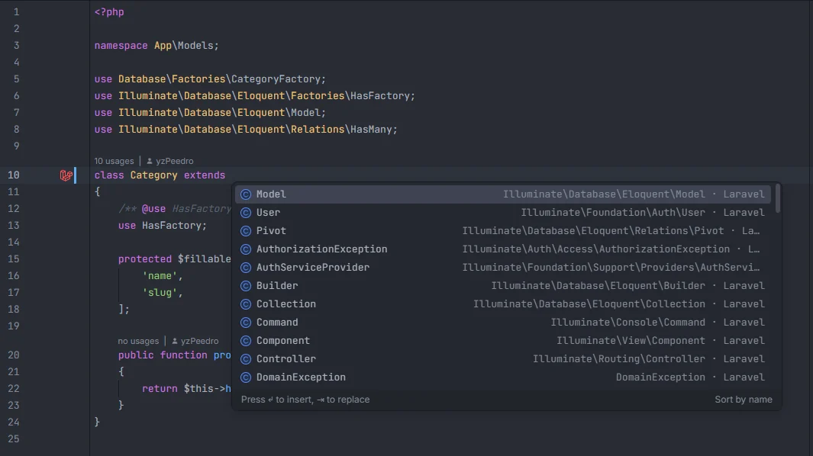
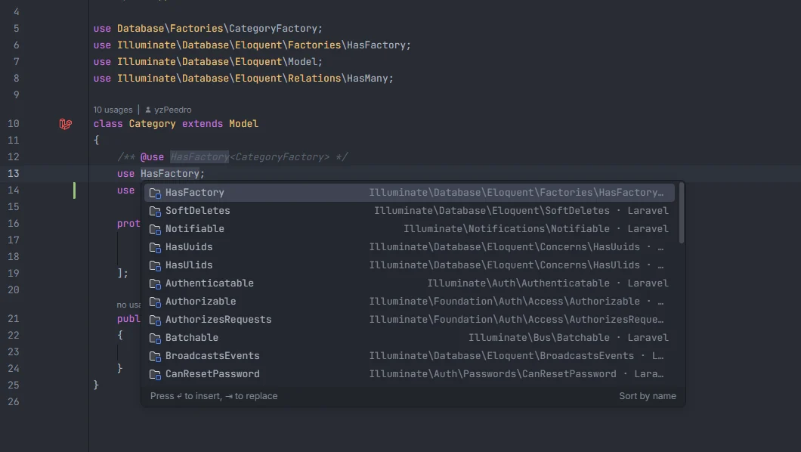

# Types and inheritance

After `extends`, `implements` and a `use` inside a class body, the plugin suggests the Laravel base classes, interfaces and traits that make sense there, the ones from the packages you have installed, and your own project's classes, interfaces and traits, with the ones that fit the folder ranked first: a model gets `Model`, `HasFactory` and `SoftDeletes` at the top, a job gets `ShouldQueue` and `Queueable`. It also treats a model that extends another model as a model, with the parent's relations and scopes.

<p align="center"></p>
<p align="center"><sub>After <code>extends</code> in <code>app/Models</code>: <code>Model</code>, <code>User</code> and <code>Pivot</code> first</sub></p>

## How to use it

```php
class Category extends |                    // base classes
class Order extends Model implements |      // interfaces
class SendInvoice implements ShouldQueue, | // more interfaces after a comma
interface Repository extends |              // interfaces

class Product extends Model
{
    use |                                   // traits
    use HasFactory, |                       // more traits after a comma
}
```

Type after the keyword (or after the comma) or press Ctrl+Space there. What you type is matched against the short class name, so `Soft` finds `SoftDeletes` and `Illuminate\Database\Eloquent\Soft` does too.

## What you see

- Each item is the short name (`HasFactory`) with the detail `full name · origin`, where the origin is `Laravel`, `package` or `project`, and a one-line description as documentation (`Model factories`, `Soft deletes`, `Run on the queue`…).
- Icons: class for `extends`, interface for `implements`, module for traits.
- **Ranking:** the types preferred for the file's folder come first, in the order of the table below; then Laravel's types; then package and project types; alphabetically within each group.
- **Insertion:** when the type is already imported (a `use` line that ends with `\HasFactory`, imports it by its full name, or aliases it `as HasFactory`), the short name is inserted. Otherwise the fully qualified name is inserted with a leading backslash (`\Illuminate\Database\Eloquent\Factories\HasFactory`); no `use` line is added.

<p align="center"></p>
<p align="center"><sub>After <code>use</code> in a model: <code>HasFactory</code>, <code>SoftDeletes</code>, <code>Notifiable</code>, <code>HasUuids</code>, <code>HasUlids</code> first</sub></p>

### Preferred types by folder

The folder is matched anywhere in the file's path.

| Folder | After `extends` | After `implements` | After `use` |
| --- | --- | --- | --- |
| `/Models/` | `Model`, `User`, `Pivot` | `MustVerifyEmail`, `HasLocalePreference`, `HasMedia`, `FilamentUser` | `HasFactory`, `SoftDeletes`, `Notifiable`, `HasUuids`, `HasUlids`, `HasApiTokens`, `HasRoles` |
| `/Http/Controllers/` | `Controller` | | `AuthorizesRequests`, `ValidatesRequests` |
| `/Http/Requests/` | `FormRequest` | | |
| `/Http/Resources/` | `JsonResource`, `ResourceCollection` | | |
| `/Jobs/` | | `ShouldQueue`, `ShouldBeUnique`, `ShouldBeEncrypted` | `Queueable`, `Dispatchable`, `InteractsWithQueue`, `SerializesModels`, `Batchable` |
| `/Listeners/` | | `ShouldQueue`, `ShouldQueueAfterCommit` | `InteractsWithQueue`, `Queueable` |
| `/Events/` | | `ShouldBroadcast`, `ShouldBroadcastNow`, `ShouldDispatchAfterCommit` | `Dispatchable`, `InteractsWithSockets`, `SerializesModels` |
| `/Mail/` | `Mailable` | `ShouldQueue` | `Queueable`, `SerializesModels` |
| `/Notifications/` | `Notification` | `ShouldQueue` | `Queueable` |
| `/Rules/` | | `ValidationRule`, `DataAwareRule`, `ValidatorAwareRule` | |
| `/Casts/` | | `CastsAttributes`, `CastsInboundAttributes` | |
| `/Scopes/` | | `Scope` | |
| `/Observers/` | | `ShouldHandleEventsAfterCommit` | |
| `/Policies/` | | | `HandlesAuthorization` |
| `/Providers/` | `ServiceProvider` | `DeferrableProvider` | |
| `/Console/` | `Command` | `Isolatable`, `PromptsForMissingInput` | |
| `/View/Components/` | `Component` | | |
| `/Livewire/` | `Component`, `Form` | | |
| `/Exceptions/` | `Exception`, `RuntimeException`, `HttpException` | | |
| `database/factories/` | `Factory` | | |
| `database/seeders/` | `Seeder` | | |
| `tests/` | `TestCase` | | `RefreshDatabase`, `LazilyRefreshDatabase`, `WithFaker`, `DatabaseTransactions` |

## Details

### The lists

- **Base classes (47):** Eloquent `Model`, `Foundation\Auth\User`, `Pivot`, `MorphPivot`, `Factory`, `Seeder`, `Migration`, custom Eloquent `Builder` and `Collection`, `FormRequest`, `JsonResource`, `ResourceCollection`, `Controller`, `ServiceProvider` and the Event, Auth and Route service providers, `Command`, `GeneratorCommand`, `Mailable`, `Notification`, `View\Component`, `Facade`, the exception `Handler`, Laravel's `TestCase`, `Support\Collection`, `Fluent`, `Manager`, `AuthorizationException`, `ValidationException`, Symfony's `HttpException` and PHP's `Exception`, `RuntimeException`, `InvalidArgumentException`, `LogicException` and `DomainException`; from packages, Livewire `Component` and `Form`, Spatie Laravel Data `Data`, Nova `Resource`, Filament `Resource`, `Page` and `Widget`, Spatie Permission `Role` and `Permission`, Sanctum `PersonalAccessToken`, and your `Tests\TestCase` (offered only in files under `tests/`).
- **Interfaces (44):** the queue contracts (`ShouldQueue`, `ShouldQueueAfterCommit`, `ShouldBeUnique`, `ShouldBeUniqueUntilProcessing`, `ShouldBeEncrypted`), broadcasting (`ShouldBroadcast`, `ShouldBroadcastNow`, `HasBroadcastChannel`), `ShouldDispatchAfterCommit`, `ShouldHandleEventsAfterCommit`, the auth contracts (`MustVerifyEmail`, `Authenticatable`, `CanResetPassword`, `Authorizable`), validation rules (`ValidationRule`, `DataAwareRule`, `ValidatorAwareRule`), casts (`CastsAttributes`, `CastsInboundAttributes`, `Castable`, `SerializesCastableAttributes`), the Eloquent `Scope`, the support contracts (`Arrayable`, `Jsonable`, `Htmlable`, `Responsable`, `Renderable`, `DeferrableProvider`), `HasLocalePreference`, `UrlRoutable`, `Attachable`, `Isolatable`, `PromptsForMissingInput`, PHP's `JsonSerializable`, `Stringable`, `Countable`, `ArrayAccess` and `IteratorAggregate`; from packages, Spatie Media Library `HasMedia`, Filament `FilamentUser` and `HasAvatar`, Sanctum `HasApiTokens`, Spatie Sitemap `Sitemapable` and Spatie Feed `Feedable`.
- **Traits (56):** `HasFactory`, `SoftDeletes`, `HasUuids`, `HasUlids`, `Prunable`, `MassPrunable`, `BroadcastsEvents`, `Notifiable`, the job and event `Dispatchable`, both `Queueable` traits, `InteractsWithQueue`, `SerializesModels`, `Batchable`, `InteractsWithSockets`, `InteractsWithBroadcasting`, `AuthorizesRequests`, `ValidatesRequests`, `HandlesAuthorization`, the auth implementations (`Authenticatable`, `CanResetPassword`, `MustVerifyEmail`, `Authorizable`), `Macroable`, `Conditionable`, `Tappable`, `ForwardsCalls`, `Localizable`, `ConfirmableTrait`, `Prohibitable` and the testing traits (`RefreshDatabase`, `LazilyRefreshDatabase`, `DatabaseTransactions`, `DatabaseMigrations`, `DatabaseTruncation`, `WithFaker`, `WithoutMiddleware`); from packages, Sanctum and Passport `HasApiTokens`, Fortify `TwoFactorAuthenticatable`, Jetstream `HasProfilePhoto` and `HasTeams`, Scout `Searchable`, Cashier `Billable`, Pennant `HasFeatures`, Spatie `HasRoles`, `InteractsWithMedia`, `LogsActivity`, `HasSlug`, `HasTranslations` and `HasTags`, Livewire `WithPagination` and `WithFileUploads`, Filament `InteractsWithForms` and Laravel Auditing `Auditable`.

### What is left out

- A package type is offered only when the package's name (such as `"laravel/sanctum"`) appears in your `composer.json`.
- A Laravel class (`Illuminate\…`) that the installed `vendor/laravel/framework` doesn't have is left out, so an older project won't see `HasUlids`, `ShouldQueueAfterCommit` or `Prohibitable` if its version lacks them. The plugin checks that the class's file exists without reading it. Without `vendor/`, everything is offered.
- **Project types** are your classes (after `extends`), interfaces (after `implements` and after `extends` in an interface) and traits (after `use`), read from the PHP files under `app/`, `database/factories/`, `database/seeders/` and `routes/` plus `bootstrap/app.php` and `bootstrap/providers.php`, with a namespace. Their documentation reads "Defined in this project", or "Abstract class of this project" for abstract classes.

### Where it triggers

- `extends` in a `class` declaration: base classes. In an `interface` declaration: interfaces.
- `implements`, and each comma after the `implements` list: interfaces.
- `use` as the first word of a statement inside braces (a class, trait or enum body), and each comma after it: traits. A `use` import at the top of the file and a closure's `use (…)` are not treated as traits.
- Nothing triggers inside the argument list of a call, even after a comma.

### Models that extend models

The plugin's Eloquent features know a class is a model when it lives under a `Models` folder in `app/` (`app/Models/**` or `app/**/Models/**`) and extends `Model`, `Authenticatable`, `Pivot`, `MorphPivot`, `User` or a class whose name ends in `Model`. A class there that extends another model is a model too, at any depth:

```php
class Product extends Model { … }              // relations: category(); scopes: published
class DigitalProduct extends Product { … }     // + downloads()
class Ebook extends DigitalProduct { }         // inherits category(), downloads() and published
```

- **Relations and scopes are inherited** from every ancestor, so `$ebook->` completes `category` and `downloads`, `Ebook::` completes `published`, and Ctrl+click on `Ebook::published()` opens `scopePublished` in `Product`. A method with the same name in the child wins over the parent's.
- **The table is not inherited.** `Ebook` is mapped to `ebooks` (or to its own `$table` or `#[Table]`), so its columns are those of that table.
- Parents are matched by their short class name.

## Settings and permissions

No setting and no optional permission.

## Related

- [Static completion](Static-Completion.md)
- [PSR-4 namespaces](Namespaces.md)
- [Model members](Model-Members.md) and [Scopes](Scopes.md)
- [File templates](File-Templates.md)
- [All Classes](Hub-Classes.md) in the hub

---
[← Wiki home](Home.md)
