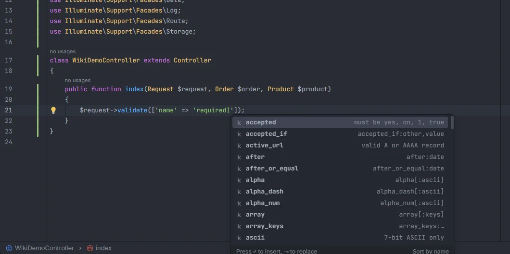
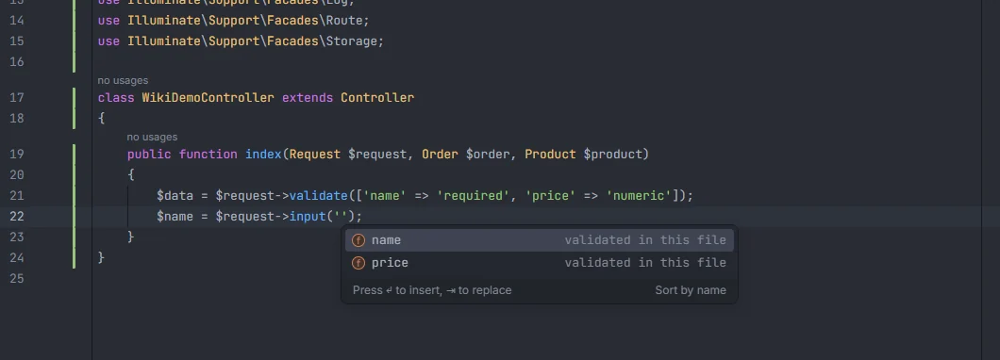

# Validation rules

Rule names complete in every place Laravel reads validation rules: `$request->validate()`, `Validator::make()`, `validator()`, Form Request `rules()` and `$rules` properties, in pipe strings and in arrays. The list is the one your installed Laravel version has, read from `vendor/laravel/framework`, and Ctrl+click on a rule opens the framework method that implements it. The fields you validate also complete in `$request->input()`, `old()` and friends.

<p align="center">validate() listing accepted, accepted_if, active_url, after, after_or_equal, alpha, alpha_dash, alpha_num, array, array_keys and ascii with their hints" width="760"></p>
<p align="center"><sub>Rules after <code>required|</code>, with a hint of each rule's parameters</sub></p>

## How to use it

### Where rules complete

| Context | Where the rules are |
| --- | --- |
| `->validate([…])`, such as `$request->validate([…])` | values of the array in the 1st argument |
| `$this->validate($request, […])` | values of the array in the 2nd argument |
| `->validateWithBag('bag', […])` | values of the array in the 2nd argument |
| `Validator::make($data, […])`, `Validator::validate($data, […])` | values of the array in the 2nd argument |
| `validator($data, […])` | values of the array in the 2nd argument |
| `return […]` inside any method named `rules` (Form Requests, Livewire forms, custom classes) | values of the returned array |
| `$rules = […]` (a `$rules` property or variable) | values of the array |

The rule must be a string value in the array, not a key. Nested arrays work at any depth:

```php
$request->validate([
    'email' => 'required|email|exists:users,email',
    'tags' => ['array', 'max:3'],
    'tags.*' => ['string', 'distinct'],
]);
```

### Parts of a rule string

A rule string is split on `|`, and each rule on `:` and `,`. Where the cursor is decides what completes:

| Cursor | Suggests |
| --- | --- |
| On a rule name (before its `:`) | Rule names |
| 1st parameter of `exists:` or `unique:` | Table names from your migrations |
| 2nd parameter of `exists:` or `unique:` | Columns of that table (a `connection.table` prefix is ignored) |
| Any other parameter | nothing |

```php
'email' => 'required|exists:users,email',
//                          ^ tables  ^ columns of users
```

Picking a rule replaces only the current rule, up to the next `|`, `:` or `,`, so `'required|strng|max:3'` with the cursor in `strng` becomes `'required|string|max:3'`.

## What you see

Each rule shows a short hint:

| Rule | Detail |
| --- | --- |
| `accepted` | `must be yes, on, 1, true` |
| `between` | `between:min,max` |
| `exists` | `exists:table,column` |
| `unique` | `unique:table,column,except,idColumn` |
| `email` | `email[:rfc,dns,spoof,filter]` |
| A rule the plugin has no hint for, that takes parameters | `rule:…` |
| A rule the plugin has no hint for, without parameters | the rule's name |

Suggestions whose name starts with what you typed come first, then the ones that only contain it, each group in alphabetical order.

## Where the rules come from

**With `vendor/laravel/framework` installed** (Laravel 6 to 13), the list is read from the framework's own source, so it matches the installed version exactly:

- every `validate…` method of `Illuminate\Validation\Concerns\ValidatesAttributes` (and the traits and parents it uses) whose first parameter is `$attribute`, turned into snake case (`validateRequiredIf` → `required_if`);
- the rule names listed in `Illuminate\Validation\Validator`'s `$implicitRules`, `$dependentRules`, `$excludeRules`, `$sizeRules`, `$numericRules` and `$fileRules`.

A rule added in a later Laravel version is therefore not suggested in an older project, and is reported as unknown there.

**Without `vendor/`** (before `composer install`), the plugin uses its built-in list of 111 rules: 108 from `accepted` to `url`, plus `uppercase`, `ulid` and `uuid`.

Custom rule classes (`new Uppercase`) and rules registered with `Validator::extend()` aren't part of the string list; the hub's [Validation Rules](Hub-Rules.md) section lists your custom rules. In `Validator::extend('name', fn`, typing `fn` completes the closure with its `$attribute`, `$value` and `$parameters` arguments ([Typed closures](Typed-Closures.md)).

## Ctrl+click

| Ctrl+click on | Opens |
| --- | --- |
| A rule name | Its `validate…` method in `vendor/laravel/framework` (or the line of the `Validator` property that lists it). Rules from the built-in list, used without `vendor/`, have no target. |
| The table in `exists:` / `unique:` | The migration that creates the table |
| The column in `exists:` / `unique:` | The column in its migration |

## Request fields

The fields you validate complete wherever the request is read:

<p align="center">input('') listing name and price, both marked validated in this file" width="760"></p>
<p align="center"><sub>The fields validated in the same method, in <code>$request->input('')</code></sub></p>

| Call | Arrays too |
| --- | --- |
| `$request->…('…')`, `request()->…('…')` and `$this->request->…('…')` with `input`, `get`, `post`, `query`, `string`, `str`, `integer`, `float`, `boolean`, `date`, `enum`, `collect`, `array`, `has`, `hasAny`, `filled`, `anyFilled`, `missing`, `exists`, `isNotFilled`, `only`, `except`, `file`, `hasFile`, `validated` or `safe` | yes: `$request->only(['name', 'price'])` |
| `Request::input('…')` and the other methods above on the `Request` facade | yes |
| `request('…')` | yes |
| `old('…')` | no |

The fields come from:

1. the keys of every rules array in the same file, with the detail *validated in this file*;
2. the rules of each Form Request typed as a parameter in the file (`StoreOrderRequest $request`), found through the file's `use` statements and the PSR-4 map of `composer.json`, with the class name as detail;
3. in Blade views, the rules of every class in `app/Http/Requests/` (up to 300 files), so `old('email')` in a form completes.

Keys with `*`, `$` or `{` (such as `items.*.id`) are left out. Fields are listed in alphabetical order, each once.

## Details

- Rules are only completed in array values or in a `rules()` method's returned array, so a plain string argument such as `$validator->validate('x')` is left alone.
- A value with `$`, `{` or `*`, or a string joined with `.` to another value, is never reported as an unknown rule.
- The framework rule list is reloaded when `composer.lock` or `vendor/composer/installed.json` changes (after `composer install` or `update`).
- Nothing here runs PHP; the framework and project files are only read.

## Settings and permissions

- `unknownRuleInspection` (on by default) underlines rule names your Laravel version doesn't have. See [Unknown validation rules](Inspection-Unknown-Rules.md).
- Only `project.read` is needed. See [Settings](Settings.md) and [Permissions](Permissions.md).

## Related

- [Unknown validation rules](Inspection-Unknown-Rules.md)
- [Extract Form Request](Extract-Form-Request.md): turn `$request->validate([…])` into a Form Request
- [Eloquent columns and relations](Eloquent-Columns-and-Relations.md): tables and columns
- [Validation Rules in the hub](Hub-Rules.md) and [Form Requests in the hub](Hub-Form-Requests.md)
- [Snippets](Snippets.md): Form Request snippets

---
[← Wiki home](Home.md)
