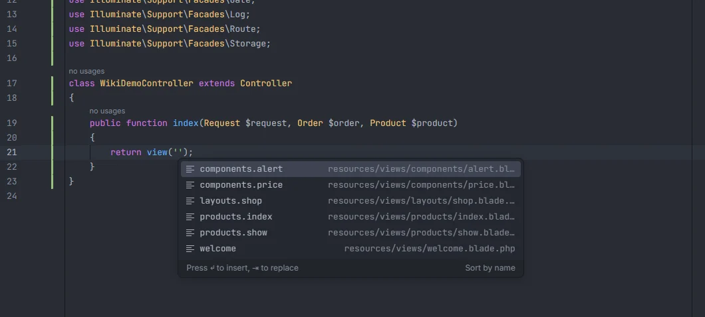
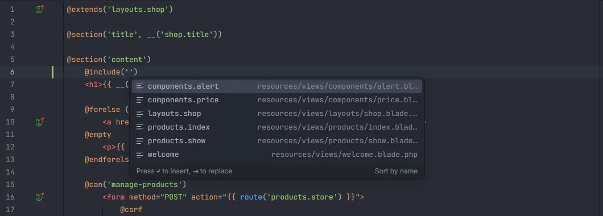

# Views

Wherever Laravel expects a view name, the plugin suggests every view under `resources/views` by its dotted name, shows the file behind each one, and opens the file on Ctrl+click. A gutter icon on each view string jumps to the file as well.

<p align="center"></p>
<p align="center"><sub>View names in <code>view('')</code>, each with its file</sub></p>

## How to use it

Type inside the quotes of any of these calls or directives. Function, method and facade names are matched case-insensitively.

### PHP

| Call | Argument | Arrays too |
| --- | --- | --- |
| `view('…')` | 1st | no |
| `View::make('…')`, `View::exists('…')` | 1st | no |
| `View::first([…])` | 1st | yes |
| `Route::view('/uri', '…')` | 2nd | no |
| `->view('…')` on any object (mailables, `MailMessage`, notifications…) | 1st | no |
| `->markdown('…')`, `->text('…')` | 1st | no |
| `->layout('…')` (Livewire components) | 1st | no |

```php
return view('products.index', ['products' => $products]);
Route::view('/about', 'about');
return View::first(['custom.dashboard', 'dashboard']);
return (new MailMessage)->markdown('mail.order.shipped', ['order' => $this->order]);
```

### Blade

<p align="center"></p>
<p align="center"><sub>The same list in <code>@include('')</code></sub></p>

| Directive | Argument | Arrays too |
| --- | --- | --- |
| `@include('…')`, `@includeIf('…')` | 1st | no |
| `@extends('…')` | 1st | no |
| `@each('…', $items, 'item')` | 1st | no |
| `@component('…')` | 1st | no |
| `@includeWhen($condition, '…')`, `@includeUnless($condition, '…')` | 2nd | no |
| `@includeFirst([…])` | 1st | yes |

The PHP calls above also work inside Blade's `{{ }}`, `{!! !!}`, `@php … @endphp` and directive lines.

## What you see

Each suggestion is a view name, with the view's file (relative to the project) as detail:

| File | View name |
| --- | --- |
| `resources/views/welcome.blade.php` | `welcome` |
| `resources/views/products/index.blade.php` | `products.index` |
| `resources/views/components/alert.blade.php` | `components.alert` |
| `resources/views/legacy/page.php` | `legacy.page` |

Suggestions whose name starts with what you typed come first, then the ones that only contain it, each group in alphabetical order. Typing filters by substring, ignoring case. At most 500 suggestions are listed. Picking one replaces the whole string up to the closing quote.

## Where the names come from

Every `*.php` file under `resources/views/` (up to 10,000 files), whether it ends in `.blade.php` or only `.php`. The name is the path below `resources/views/` without the extension, with `/` turned into `.`. The list is sorted by name.

Namespaced views from packages (`mail::message`, `package::view`) and views registered with `View::addNamespace()` or `loadViewsFrom()` aren't indexed.

## Ctrl+click and the gutter

- Ctrl+click on a view name opens the view file.
- Next to every closed view string that matches a view, a gutter icon with the tooltip *Go to view `resources/views/…`* opens the file. See [Gutter markers](Gutter-Markers.md).

## Details

- The plugin reads the folder; it doesn't need PHP, Docker or `vendor/`.
- Strings with `$`, `{` or `*`, strings joined with `.` to other values and names containing `::` are never reported as unknown, because their real value can't be known from the text.
- Only the arguments listed above are views: in `view('x', ['k' => 'v'])` the array is data, and in `Route::view('/a', 'about')` the URI is not a view.
- Named arguments such as `new Content(view: '…')` aren't recognised as view names.
- The index is rebuilt after a file under `resources/views/` is created, changed or removed, whether in the editor or on disk.

## Settings and permissions

- `unknownViewInspection` (on by default) underlines view names that don't exist and offers the closest view as a quick fix, in one usage or all of them. See [Unknown views](Inspection-Unknown-Views.md).
- Completion and navigation only need `project.read`. See [Settings](Settings.md) and [Permissions](Permissions.md).

## Related

- [Unknown views](Inspection-Unknown-Views.md)
- [Blade](Blade.md): components, sections, stacks and directives
- [Gutter markers](Gutter-Markers.md)
- [Go to Related Class or View](Related-Class-or-View.md)
- [Views in the hub](Hub-Views.md)

---
[← Wiki home](Home.md)
